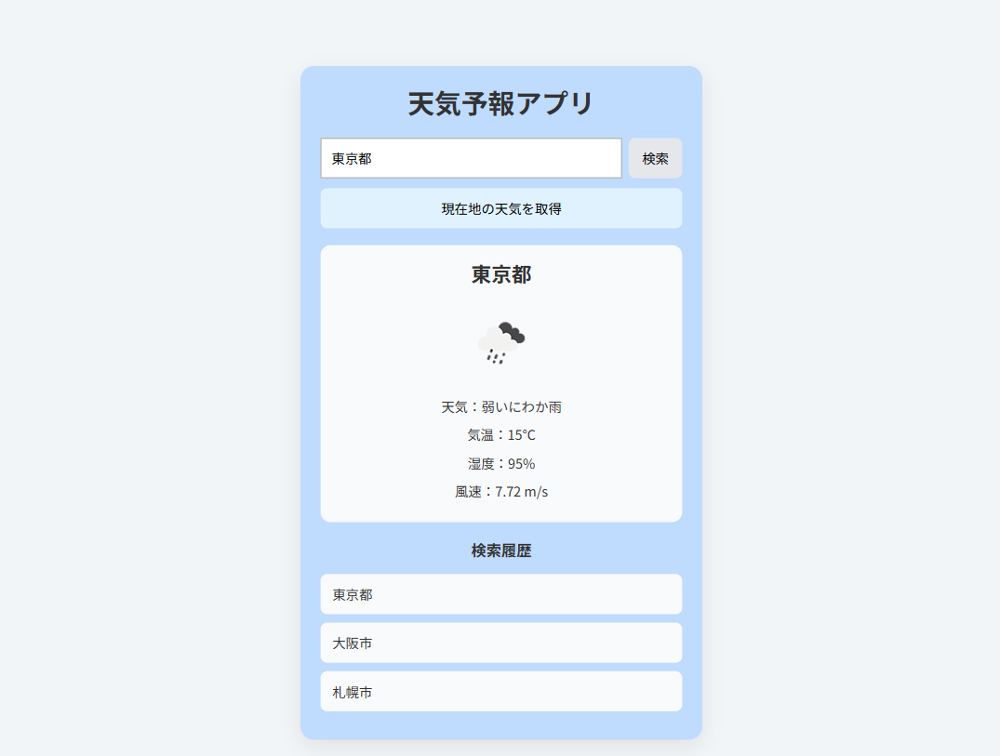
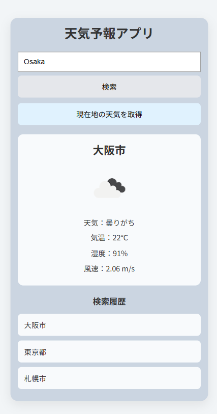

# Weather App（JavaScript版）

天気情報を検索・表示できる天気予報アプリです。  
OpenWeather API と ZipCloud API を利用し、現在の天気情報・5日間予報・郵便番号検索・お気に入り登録・検索履歴機能を実装しています。

---

## プロジェクト概要

本アプリケーションは JavaScript を使用した天気予報アプリです。

都市名・都道府県名・郵便番号・現在地情報を利用して天気情報を取得できます。

---

## アプリ画面

### PC表示



### モバイル表示



---

## 主な機能

- 都市名検索
- 都道府県名検索
- 郵便番号検索
- 現在地の天気取得
- 現在の天気表示
- 5日間予報表示
- 天気アイコン表示
- 気温・湿度・風速表示
- お気に入り登録
- 検索履歴表示
- 履歴・お気に入りクリックによる再検索
- 天候による背景色変更
- レスポンシブ対応

---

## 使用技術

- HTML
- CSS
- JavaScript
- localStorage
- Docker / Docker Compose
- Nginx
- OpenWeather API
- ZipCloud API

---

## 構成の見直しについて

### 2026年10月：セキュリティを契機とした構成の見直し

本アプリは当初、Laravel・PHP・MySQLを含むDocker環境で開発していました。

PHPの脆弱性に関する情報をきっかけに、開発環境で使用しているミドルウェアのバージョンや構成を見直しました。

調査の結果、天気情報の取得や画面表示はJavaScriptで完結しており、PHP・Laravel・MySQLはアプリの動作に必要ないことが分かりました。

そのため、不要なバックエンド環境を削除し、NginxでHTML・CSS・JavaScriptを配信するシンプルな構成へ変更しました。

主な対応内容は以下のとおりです。

- 不要なPHP・Laravel・MySQL・phpMyAdminへの依存を解消
- Docker ComposeをNginxのみの構成に変更
- Nginxを1.21.1から1.30.6へ更新（2026年10月時点）
- 天気アプリの配置先を `src/` から `site/` に変更
- 構成変更後に各機能の動作を確認

この見直しにより、アプリの機能を維持しながら、不要なミドルウェアを削減し、構成の簡素化とセキュリティリスクの低減を図りました。

---

## セットアップ方法

### 1. リポジトリを取得

```bash
git clone https://github.com/shimodum/weather-app.git
cd weather-app
```

### 2. APIキーを設定

OpenWeather APIでAPIキーを取得してください。

https://openweathermap.org/api

サンプルファイルをコピーします。

```bash
cp site/js/config.example.js site/js/config.js
```

作成した `site/js/config.js` を開き、取得したAPIキーを設定してください。

```javascript
export const CONFIG = {
  API_KEY: 'YOUR_API_KEY'
};
```

※ `YOUR_API_KEY` を実際のAPIキーに置き換えてください。

### 3. Dockerコンテナを起動

```bash
docker compose up -d
```

### 4. ブラウザでアクセス

以下のURLにアクセスしてください。

http://localhost:8081/

### 5. コンテナを停止する場合

```bash
docker compose down
```

---

## API設定

本アプリケーションでは、OpenWeather APIを使用して天気情報を取得しています。

APIキーの取得先：
https://openweathermap.org/api

APIキーは `site/js/config.js` に設定します。

設定ファイルのサンプルとして、`site/js/config.example.js` を用意しています。

```javascript
export const CONFIG = {
  API_KEY: 'YOUR_API_KEY'
};
```

具体的な設定手順は「セットアップ方法」を参照してください。

### 注意事項

- `site/js/config.js` はGit管理対象外です。
- APIキーをGitHubなどの公開リポジトリにコミットしないでください。
- 本アプリはブラウザから直接APIを呼び出すため、APIキーはブラウザの開発者ツールなどから確認できます。
- 現在はローカル環境での学習・動作確認を想定しています。

---

## ディレクトリ構成

```text
weather-app/
├── docker/
│   └── nginx/
│       └── default.conf
├── site/
│   ├── css/
│   │   └── style.css
│   ├── js/
│   │   ├── app.js
│   │   ├── cityMap.js
│   │   ├── config.example.js
│   │   ├── config.js
│   │   ├── ui.js
│   │   └── weatherApi.js
│   └── index.html
├── images/
│   ├── pc.png
│   └── mobile.png
├── docker-compose.yml
├── .gitignore
└── README.md
```

※ 処理の中心となる主要ファイルのみ記載しています。

※ `site/js/config.js` は各自の環境で作成するファイルであり、Git管理対象外です。

---

## 工夫した点

### API連携

OpenWeather API を利用して、現在の天気情報と5日間予報を取得しています。

郵便番号検索では、ZipCloud API で住所情報を取得し、取得した都道府県名をもとに OpenWeather API で天気情報を取得しています。

### 郵便番号検索

OpenWeather API 単体では日本の郵便番号検索が安定しない場合があったため、ZipCloud API を組み合わせる構成にしました。

例：

```txt
100-0001
↓
ZipCloud APIで住所取得
↓
東京都
↓
OpenWeather APIで天気情報取得
```

### お気に入り・検索履歴

LocalStorage を使用し、お気に入り地点と検索履歴を保存できるようにしました。

同じ地点が重複登録されないようにし、最新の検索・登録が上に表示されるようにしています。

### 5日間予報

OpenWeather の 5 day / 3 hour forecast API を利用し、日付・曜日・天気アイコン・気温を表示しています。

### UI統一

JavaScript版とReact版でデザイン・レイアウトを統一し、同じ操作感になるよう調整しました。

### 現在地取得の仕様

現在地取得は緯度・経度を利用して天気情報を取得しています。

取得される地域名が都市名検索で再検索できるとは限らないため、現在地取得で表示された地点はお気に入り登録・検索履歴の対象外としています。

---

## 動作確認項目

以下項目について動作確認を実施しています。

### 検索機能

- 東京で検索できる
- 東京都で検索できる
- 愛知で検索できる
- 100-0001で検索できる
- 1000001で検索できる
- 存在しない都市名でエラー表示される
- 存在しない郵便番号でエラー表示される
- 空入力でエラー表示される

### 天気情報・5日間予報

- 都市検索後に現在の天気情報が表示される
- 都市検索後に5日間予報が表示される
- 郵便番号検索後に現在の天気情報が表示される
- 郵便番号検索後に5日間予報が表示される
- 現在地取得後に現在の天気情報が表示される
- 現在地取得後に5日間予報が表示される

### お気に入り

- 都市検索時はお気に入り登録できる
- 郵便番号検索時はお気に入り登録できる
- 現在地取得時はお気に入りボタンが表示されない
- お気に入り一覧クリックで再検索できる
- お気に入り解除で一覧から削除される
- 再読み込み後もお気に入りが保持される

### 検索履歴

- 検索した地点が履歴に追加される
- 同一地点検索時に重複登録されない
- 最新検索が先頭に表示される
- 検索履歴クリックで再検索できる
- 現在地取得時は検索履歴に追加されない
- 再読み込み後も検索履歴が保持される

### UI

- PC表示でレイアウトが崩れない
- スマートフォン表示でレイアウトが崩れない
- 天候に応じて背景色が変更される（晴れ・曇り・雨・雪に対応）
- 読み込み中メッセージが表示される
- ボタンの hover 表示が不自然にならない
- 空入力時に前回の天気情報・5日間予報が残らない

---

## 学習ポイント

本アプリ制作を通じて以下を学習しました。

- OpenWeather APIとの連携
- ZipCloud APIとの連携
- fetch を利用した非同期通信
- Promise.all を利用した並列処理
- localStorageを利用したデータ保持
- レスポンシブデザイン
- UI設計およびファイル分割
- エラーハンドリング
- APIキー管理

---

## 今後の改善点

- ローディングアニメーション追加
- 地図連携
- TypeScript化
- 現在地取得地点のお気に入り登録対応
- エラーハンドリング強化

---

## 補足

OpenWeather API の仕様により、入力した都市名と表示される都市名が異なる場合があります。

例：

- 東京 → 東京都
- 大阪 → 大阪市
- Kyoto → 京都市

本アプリでは API のレスポンス結果をそのまま表示しているため、地域名の表記が統一されない場合があります。

日本語での検索性向上のため、都道府県名を入力した場合は、県庁所在地へ変換したうえで検索しています。

例：

- 愛知 → 名古屋
- 神奈川 → 横浜
- 沖縄 → 那覇

郵便番号検索では、ZipCloud API で住所を取得し、取得した都道府県名をもとに天気情報を検索しています。

現在地取得ではブラウザ位置情報と OpenWeather API を利用しているため、実際の現在地と完全一致しない地域名が表示される場合があります。

また、現在地取得で表示された地点名が都市名検索で再検索できるとは限らないため、現在地取得で表示された地点はお気に入り登録・検索履歴の対象外としています。